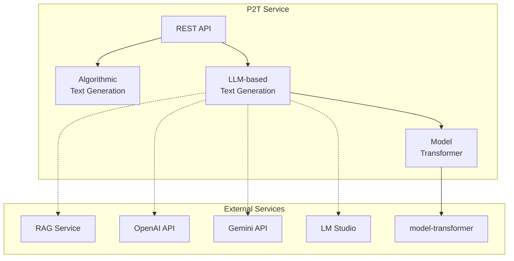

# P2T (Process-to-Text) Documentation

Welcome to the P2T service documentation. This documentation is organized into three main sections.

## Documentation Structure

```
docs/
├── dev/          # Architecture & Design
├── ops/          # Operations & Deployment
└── feat/         # Features Overview
```

## Quick Navigation

### [Development (dev/)](./dev/)
Architecture, design decisions, and technical documentation for developers.
- [Architecture Overview](./dev/architecture.md)
- [Code Structure](./dev/code-structure.md)
- [LLM Integration](./dev/llm-integration.md)
- [Data Flow](./dev/data-flow.md)

### [Operations (ops/)](./ops/)
Everything needed to run, deploy, and configure the P2T service.
- [Quick Start](./ops/quickstart.md)
- [Configuration](./ops/configuration.md)
- [Docker Deployment](./ops/docker.md)
- [Monitoring](./ops/monitoring.md)

### [Features (feat/)](./feat/)
Overview of all features and capabilities.
- [Feature Overview](./feat/overview.md)
- [Text Generation](./feat/text-generation.md)
- [LLM Providers](./feat/llm-providers.md)
- [RAG Integration](./feat/rag.md)

## Service Overview



## Key Information

| Aspect | Details |
|--------|---------|
| **Language** | Java 21 |
| **Framework** | Spring Boot 3.4.x |
| **Default Port** | 8080 |
| **API Docs** | `/swagger-ui/` |
| **Health Check** | `/actuator/health` |

## Links

- **Production**: https://woped.dhbw-karlsruhe.de/p2t/
- **Swagger UI**: https://woped.dhbw-karlsruhe.de/p2t/swagger-ui/
- **GitHub**: https://github.com/woped/P2T
- **Docker Hub**: https://hub.docker.com/r/woped/process2text
