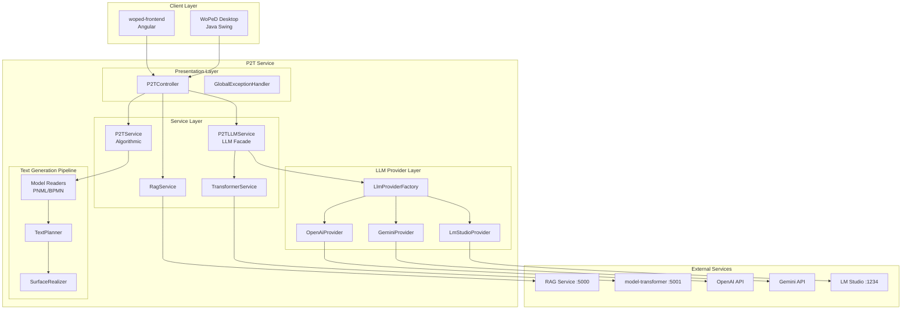
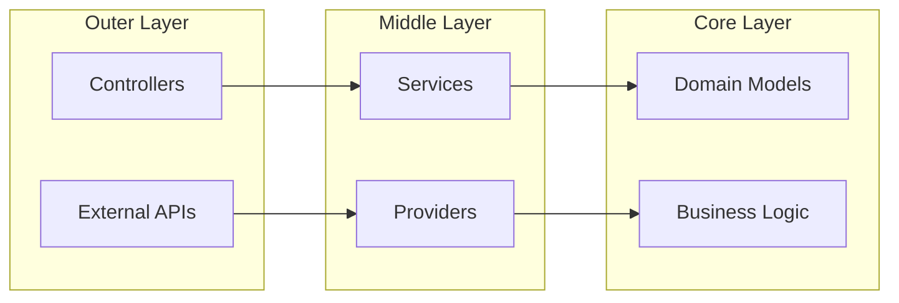
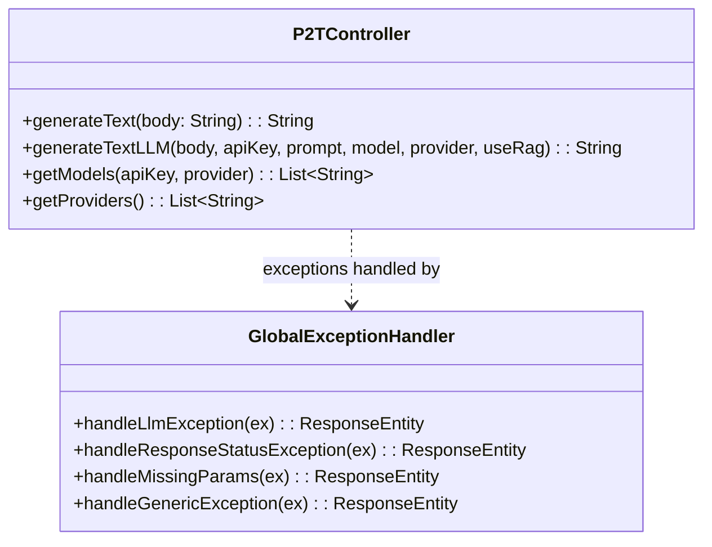
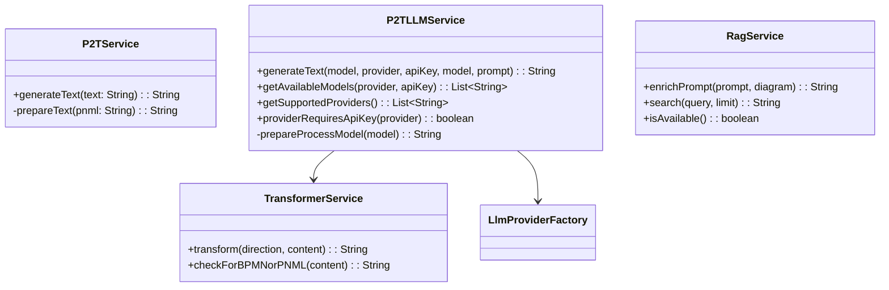
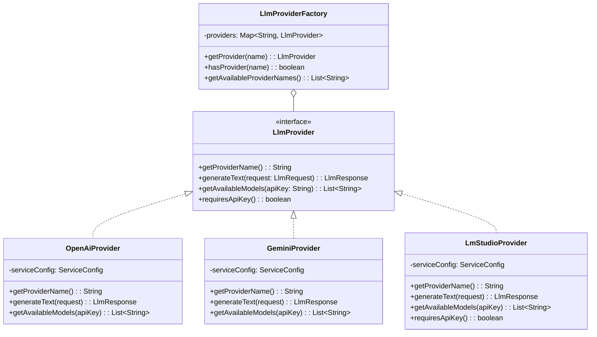
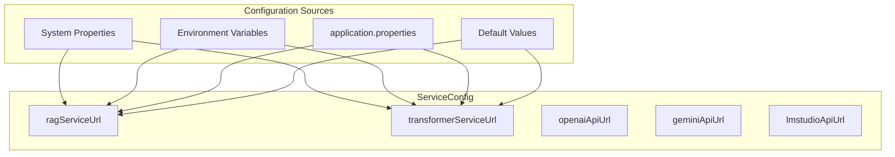
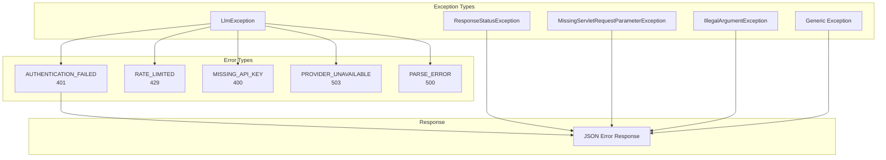

# P2T Architecture

## Overview

The P2T (Process-to-Text) service converts business process models (PNML/BPMN) into natural language text descriptions. It supports two generation approaches: algorithmic NLP-based generation and LLM-based generation.

## High-Level Architecture

## Design Principles

### Clean Architecture Layers

### Key Design Patterns

| Pattern | Usage | Location |
|---------|-------|----------|
| **Strategy** | LLM Provider abstraction | `LlmProvider` interface |
| **Factory** | Provider instantiation | `LlmProviderFactory` |
| **Facade** | LLM service orchestration | `P2TLLMService` |
| **Builder** | Request/Response construction | `LlmRequest`, `LlmResponse` |
| **Template Method** | Text generation pipeline | `TextGenerator` |

## Component Details

### Controller Layer

### Service Layer

### LLM Provider Layer

## Configuration Architecture

**Priority Order (highest to lowest):**
1. Java System Properties (`-Drag.service.url=...`)
2. Environment Variables (`RAG_SERVICE_URL=...`)
3. `application.properties` file
4. Default values in `ServiceConfig`

## Error Handling

## Thread Safety

- **ServiceConfig**: Immutable after initialization
- **LlmProviderFactory**: Thread-safe provider map (immutable after construction)
- **LlmRequest/LlmResponse**: Immutable DTOs
- **Services**: Stateless Spring beans (thread-safe by default)
