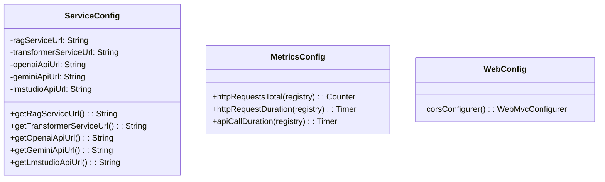
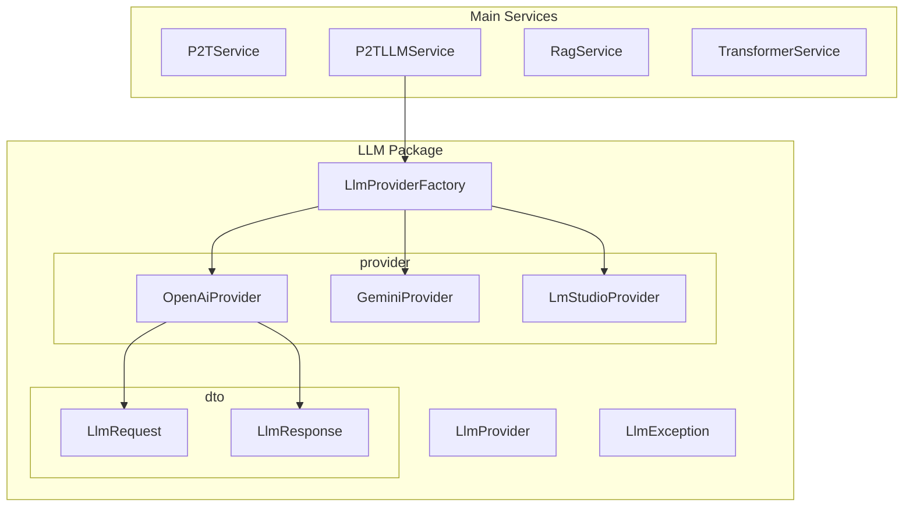
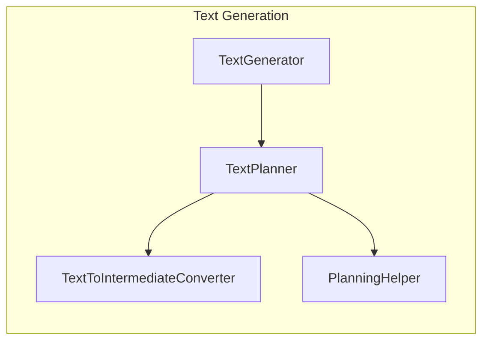
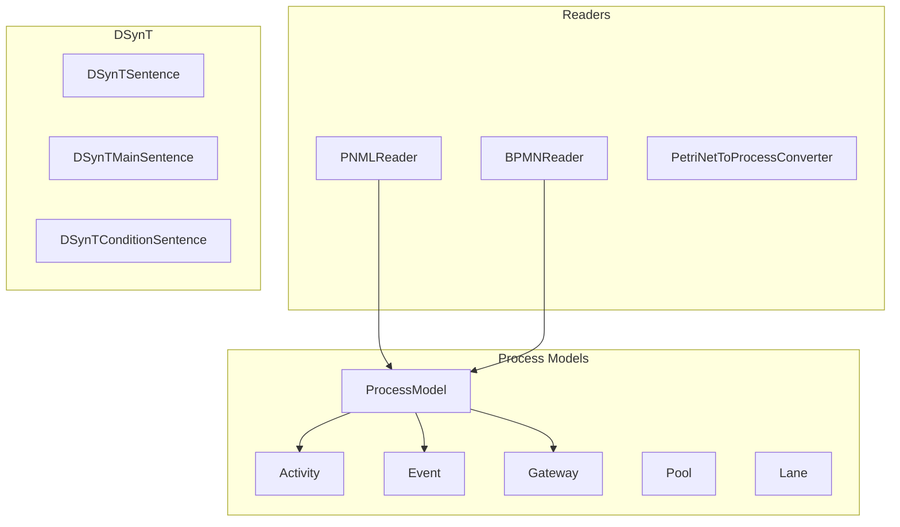

# P2T Code Structure

## Package Overview

```
src/main/java/de/dhbw/woped/process2text/
├── config/                    # Configuration classes
├── controller/                # REST controllers
├── exception/                 # Custom exceptions
├── model/                     # Domain models
│   ├── dsynt/                 # Deep Syntax Tree models
│   ├── intermediate/          # Intermediate representations
│   ├── process/               # Process model classes
│   └── reader/                # Model readers (PNML, BPMN)
└── service/                   # Business logic
    ├── content/               # Content determination
    ├── llm/                   # LLM integration
    │   ├── dto/               # Data Transfer Objects
    │   └── provider/          # LLM provider implementations
    ├── sentence/              # Sentence processing
    └── text/                  # Text generation
```

## Package Details

### config/

Configuration classes for Spring Boot application.



| File | Purpose |
|------|---------|
| `ServiceConfig.java` | External service URLs configuration |
| `MetricsConfig.java` | Micrometer metrics beans |
| `WebConfig.java` | CORS configuration |

### controller/

REST API endpoints.

| File | Purpose |
|------|---------|
| `P2TController.java` | Main API controller |
| `GlobalExceptionHandler.java` | Centralized error handling |

### service/

Business logic layer.



### service/text/

NLP text generation pipeline.



### model/

Domain model classes.



## Key Classes

### P2TController

Main REST controller with endpoints:

```java
@PostMapping("/generateText")      // Algorithmic generation
@PostMapping("/generateTextLLM")   // LLM-based generation
@GetMapping("/gptModels")          // List available models
@GetMapping("/providers")          // List providers
```

### P2TLLMService

Orchestrates LLM text generation:

```java
public String generateText(processModel, provider, apiKey, model, prompt)
public List<String> getAvailableModels(provider, apiKey)
public List<String> getSupportedProviders()
public boolean providerRequiresApiKey(provider)
```

### LlmProvider (Interface)

Strategy interface for LLM providers:

```java
String getProviderName();
LlmResponse generateText(LlmRequest request);
List<String> getAvailableModels(String apiKey);
default boolean requiresApiKey() { return true; }
```

### TextGenerator

Main NLP pipeline orchestrator:

```java
public String toText(String input) {
    // 1. Detect format (PNML/BPMN)
    // 2. Parse to ProcessModel
    // 3. Annotate with linguistic info
    // 4. Convert to RPST
    // 5. Handle rigid structures
    // 6. Generate sentence plan
    // 7. Aggregate sentences
    // 8. Insert referring expressions
    // 9. Add discourse markers
    // 10. Realize surface text
}
```

## Test Structure

```
src/test/java/de/dhbw/woped/process2text/
├── controller/
│   └── P2TControllerTest.java
├── service/
│   ├── P2TLLMServiceTest.java
│   └── llm/
│       ├── LlmProviderFactoryTest.java
│       ├── dto/
│       │   └── LlmRequestTest.java
│       └── provider/
│           └── LmStudioProviderTest.java
├── TransformerServiceTests.java
└── Process2textApplicationTests.java  # Integration tests (disabled)
```

## Resources

```
src/main/resources/
├── application.properties       # Spring configuration
├── dict/                       # WordNet dictionary files
├── nlptools.wordnet.FileProperties  # WordNet config
└── ...
```
