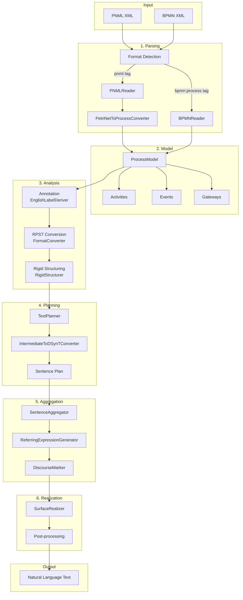
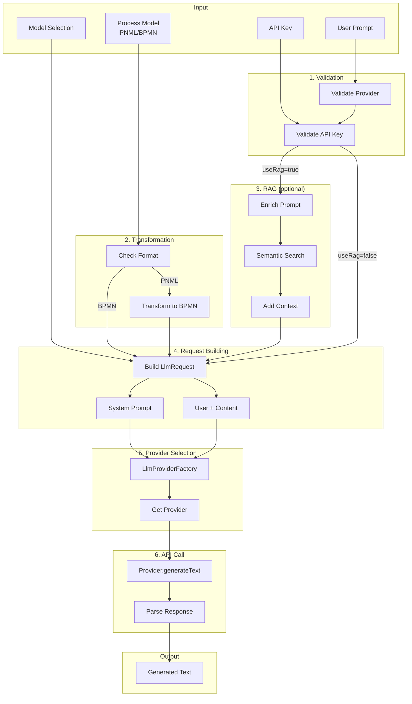
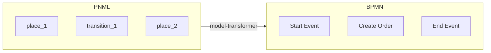
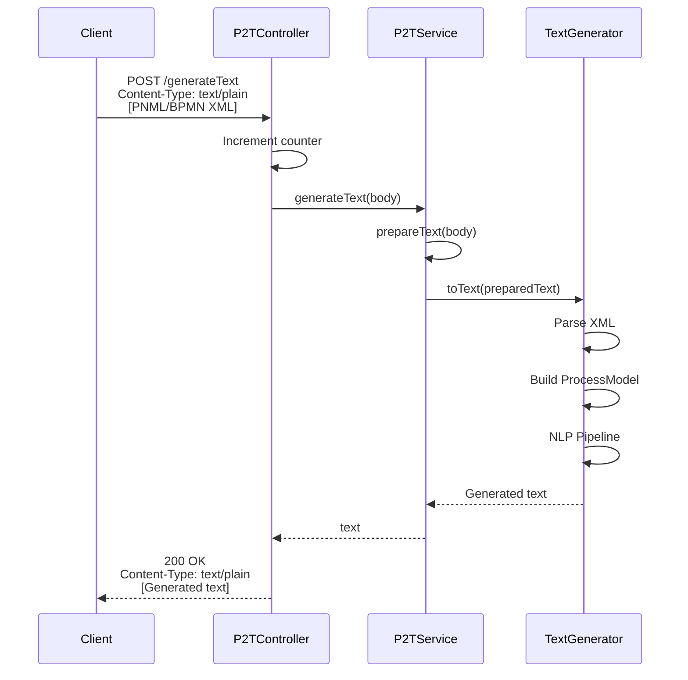
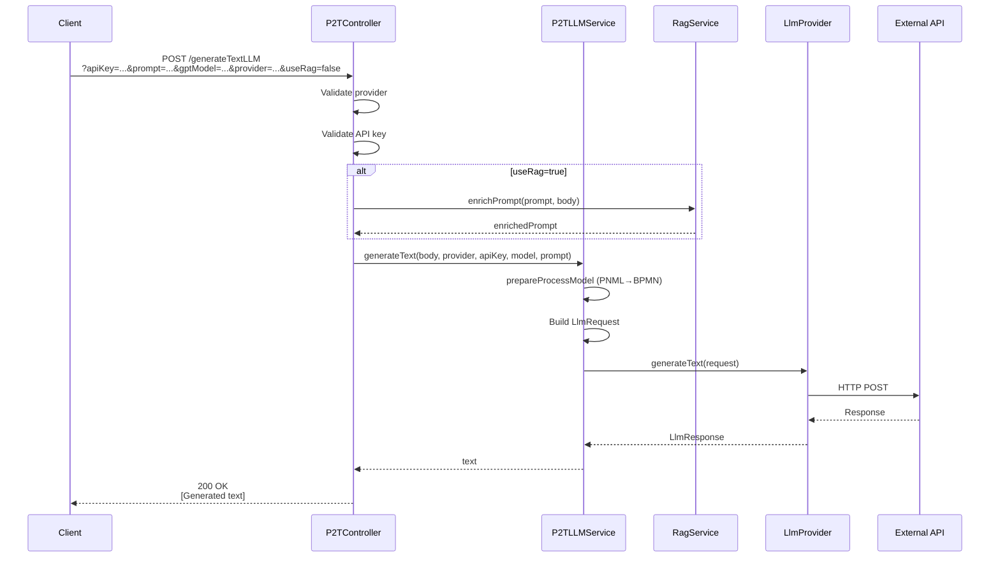
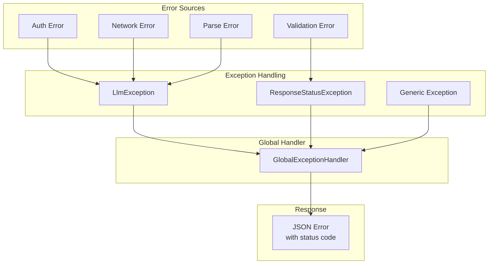

# Data Flow

## Overview

This document describes how data flows through the P2T service for both algorithmic and LLM-based text generation.

## Algorithmic Text Generation

### Stage Details

#### 1. Parsing Stage

- **Format Detection**: Checks for `<pnml>` or `<bpmn:process>` tags
- **PNML Reader**: Parses Petri Net XML into `PetriNet` object
- **BPMN Reader**: Parses BPMN 2.0 XML into `ProcessModel`
- **Converter**: Transforms Petri Net to unified `ProcessModel`

#### 2. Model Stage

The `ProcessModel` contains:
- Activities (tasks, subprocesses)
- Events (start, end, intermediate)
- Gateways (XOR, AND, OR)
- Pools and Lanes (organizational info)
- Arcs (control flow)

#### 3. Analysis Stage

- **Annotation**: Extracts verbs, business objects, roles from labels
- **RPST**: Creates Refined Process Structure Tree
- **Rigid Structuring**: Handles unstructured regions

#### 4. Planning Stage

- **TextPlanner**: Traverses RPST, creates sentence plan
- **Converter**: Transforms process elements to DSynT sentences

#### 5. Aggregation Stage

- **Aggregation**: Combines sentences with same role
- **Referring Expressions**: Adds pronouns ("he", "it")
- **Discourse Markers**: Adds connectives ("then", "meanwhile")

#### 6. Realization Stage

- **Surface Realizer**: Generates final text from sentence plan
- **Post-processing**: Cleans up formatting

## LLM-based Text Generation

### PNML to BPMN Transformation

LLMs perform better with BPMN format due to more descriptive element names:

## API Request/Response Flow

### POST /generateText (Algorithmic)

### POST /generateTextLLM

## Error Flow

