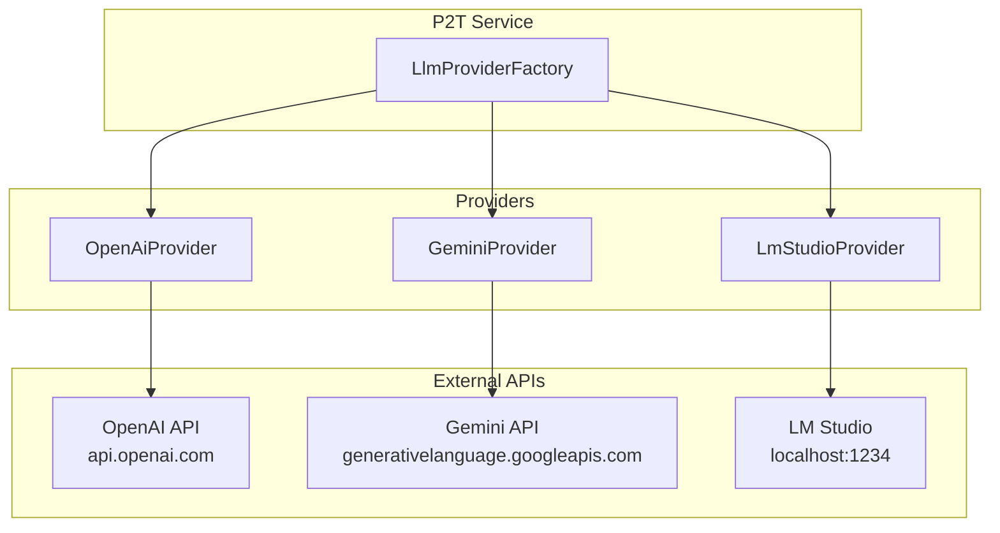
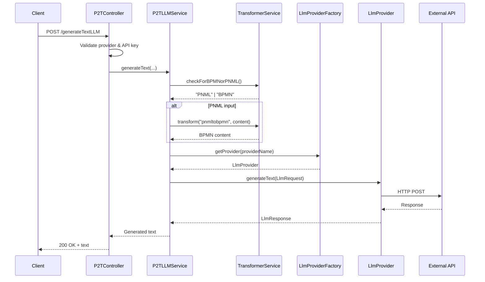
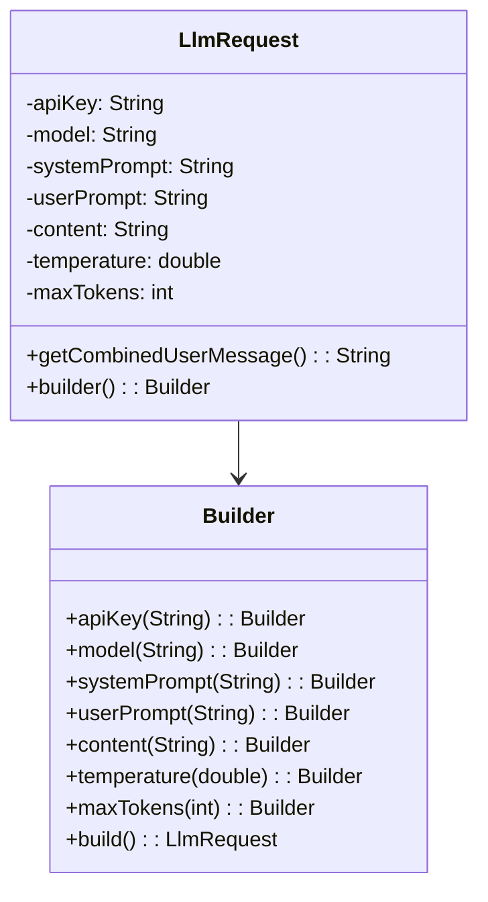
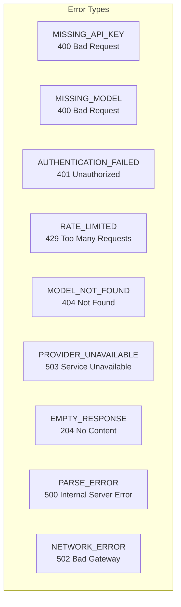
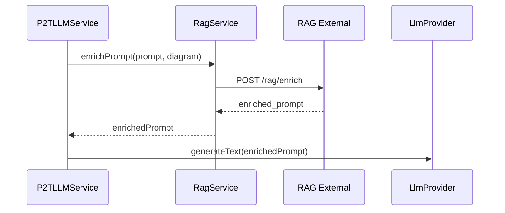

# LLM Integration

## Overview

P2T integrates with multiple Large Language Model (LLM) providers to generate natural language descriptions of business processes. The integration uses the Strategy pattern for provider abstraction.

## Supported Providers



### Provider Comparison

| Provider | API Key Required | Models | Use Case |
|----------|-----------------|--------|----------|
| **OpenAI** | Yes | GPT-4, GPT-4-turbo, GPT-3.5-turbo | Production, high quality |
| **Gemini** | Yes | gemini-1.5-pro, gemini-1.0-pro | Production, alternative |
| **LM Studio** | No | Any GGUF model | Development, offline |

## Request Flow



## LlmRequest Structure



### Default Values

| Field | Default |
|-------|---------|
| `systemPrompt` | "You are a helpful assistant." |
| `temperature` | 0.7 |
| `maxTokens` | 4096 |
| `content` | "" (empty) |

## Provider Implementation Details

### OpenAI Provider

Uses the official OpenAI Java SDK:

```java
OpenAIClient client = OpenAIOkHttpClient.builder()
    .apiKey(request.getApiKey())
    .baseUrl(baseUrl)
    .build();

ChatCompletionCreateParams params = ChatCompletionCreateParams.builder()
    .model(request.getModel())
    .maxCompletionTokens(request.getMaxTokens())
    .temperature(request.getTemperature())
    .addSystemMessage(request.getSystemPrompt())
    .addUserMessage(request.getUserPrompt())
    .addUserMessage(request.getContent())
    .build();
```

### Gemini Provider

Uses the Google GenAI SDK:

```java
Client client = Client.builder()
    .apiKey(request.getApiKey())
    .build();

GenerateContentConfig config = GenerateContentConfig.builder()
    .temperature((float) request.getTemperature())
    .maxOutputTokens(request.getMaxTokens())
    .build();

List<Content> messages = List.of(
    Content.builder().role("model").parts(...).build(),
    Content.builder().role("user").parts(...).build()
);
```

### LM Studio Provider

Uses OpenAI-compatible REST API:

```java
// POST http://localhost:1234/v1/chat/completions
{
    "model": "model-name",
    "messages": [
        {"role": "system", "content": "..."},
        {"role": "user", "content": "..."}
    ],
    "max_tokens": 4096,
    "temperature": 0.7,
    "stream": false
}
```

**Note:** Mistral models use "assistant" instead of "system" for the first role.

## Error Handling



### Error Response Format

```json
{
    "timestamp": "2024-01-15T10:30:00.000Z",
    "status": 401,
    "error": "Unauthorized",
    "message": "Authentication failed - check API key",
    "details": {
        "provider": "openai",
        "errorType": "AUTHENTICATION_FAILED"
    }
}
```

## RAG Integration

When `useRag=true`, prompts are enriched with context before LLM call:



## Model Selection

### Listing Available Models

```bash
# OpenAI
curl -H "Authorization: Bearer $API_KEY" \
  https://api.openai.com/v1/models

# Gemini
curl -H "X-Goog-Api-Key: $API_KEY" \
  https://generativelanguage.googleapis.com/v1beta/models

# LM Studio
curl http://localhost:1234/v1/models
```

### Recommended Models

| Provider | Model | Best For |
|----------|-------|----------|
| OpenAI | gpt-4-turbo | Highest quality |
| OpenAI | gpt-3.5-turbo | Cost-effective |
| Gemini | gemini-1.5-pro | Long contexts |
| LM Studio | llama-3.2-* | Privacy, offline |

## Adding a New Provider

1. Create a new class implementing `LlmProvider`:

```java
@Component
public class NewProvider implements LlmProvider {
    
    @Override
    public String getProviderName() {
        return "newprovider";
    }
    
    @Override
    public LlmResponse generateText(LlmRequest request) {
        // Implementation
    }
    
    @Override
    public List<String> getAvailableModels(String apiKey) {
        // Implementation
    }
    
    @Override
    public boolean requiresApiKey() {
        return true; // or false
    }
}
```

2. Add URL configuration to `ServiceConfig`:

```java
@Value("${newprovider.api.url:https://api.newprovider.com}")
private String newproviderApiUrl;
```

3. The `LlmProviderFactory` will automatically discover the new provider via Spring's dependency injection.
