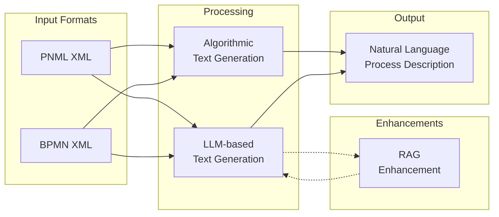

# Features Overview

All features and capabilities of the P2T (Process-to-Text) service.

## Contents

| Document | Description |
|----------|-------------|
| [Feature Overview](./overview.md) | Summary of all features |
| [Text Generation](./text-generation.md) | Algorithmic text generation |
| [LLM Providers](./llm-providers.md) | AI-powered text generation |
| [RAG Integration](./rag.md) | Retrieval Augmented Generation |

## Quick Feature Matrix

| Feature | Endpoint | Input | Output |
|---------|----------|-------|--------|
| Algorithmic Generation | `POST /generateText` | PNML/BPMN | Natural language |
| LLM Generation | `POST /generateTextLLM` | PNML/BPMN | Natural language |
| Model Listing | `GET /gptModels` | API Key | Available models |
| RAG Search | `POST /rag/search` | Query | Related documents |
| RAG Health | `GET /rag/health` | - | Health status |

## Feature Comparison

## When to Use Each Feature

| Use Case | Recommended Feature |
|----------|---------------------|
| Quick process descriptions | Algorithmic Generation |
| Detailed explanations | LLM Generation |
| Domain-specific language | LLM + RAG |
| No API keys available | Algorithmic Generation |
| Local-only processing | Algorithmic or LM Studio |
