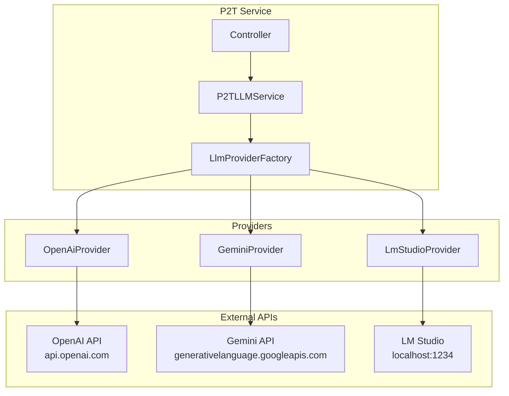
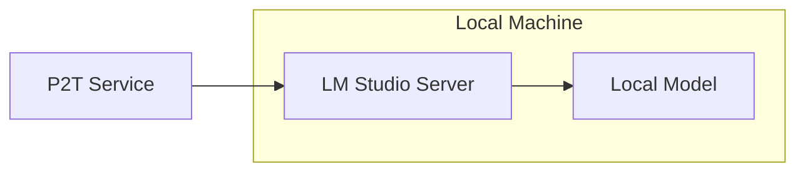
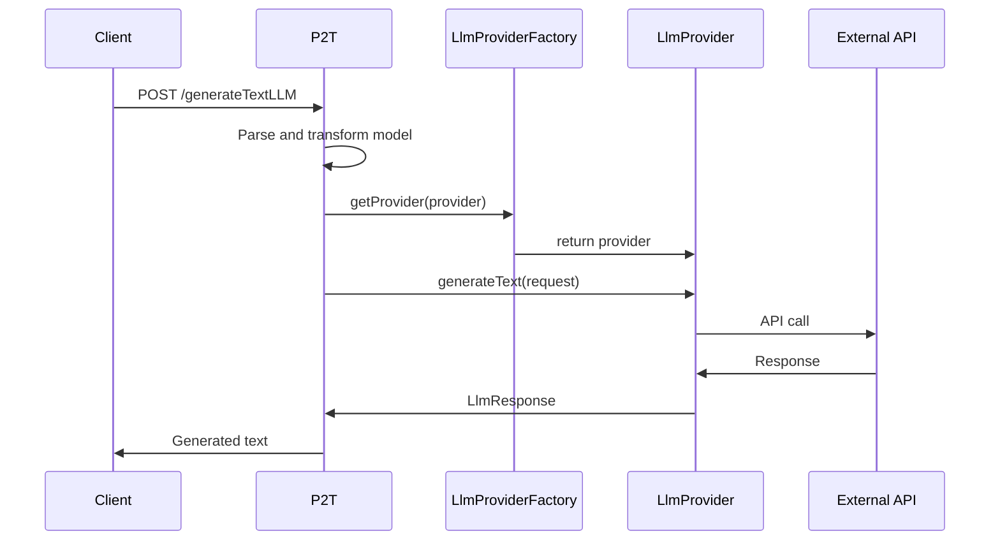

# LLM Providers

Documentation for AI-powered text generation using Large Language Models.

## Overview

P2T supports multiple LLM providers through a unified interface, allowing users to choose the best provider for their needs.



## Provider Comparison

| Feature | OpenAI | Gemini | LM Studio |
|---------|--------|--------|-----------|
| **API Key Required** | Yes | Yes | No |
| **Internet Required** | Yes | Yes | No |
| **Cost** | Per token | Per token | Free |
| **Models** | GPT-4, GPT-3.5, etc. | Gemini Pro, etc. | Local models |
| **Privacy** | Cloud-based | Cloud-based | Local only |
| **Speed** | Fast | Fast | Depends on hardware |

## OpenAI Provider

### Overview

Integration with OpenAI's GPT models for high-quality text generation.

### Supported Models

| Model | Description | Context Length |
|-------|-------------|----------------|
| gpt-4 | Most capable | 8,192 tokens |
| gpt-4-turbo | Faster, cheaper | 128,000 tokens |
| gpt-4o | Optimized | 128,000 tokens |
| gpt-3.5-turbo | Cost-effective | 16,385 tokens |

### Configuration

No service-level configuration needed. API key provided per-request.

### Usage

```bash
curl -X POST "http://localhost:8080/p2t/generateTextLLM?apiKey=sk-...&provider=openai&gptModel=gpt-4&useRag=false" \
  -H "Content-Type: text/plain" \
  -d '<pnml>...</pnml>'
```

### List Available Models

```bash
curl "http://localhost:8080/p2t/gptModels?apiKey=sk-...&provider=openai"
```

### Response Example

```json
["gpt-4", "gpt-4-turbo", "gpt-4o", "gpt-3.5-turbo", "gpt-3.5-turbo-16k"]
```

### Error Handling

| Error | Cause | Solution |
|-------|-------|----------|
| 401 Unauthorized | Invalid API key | Check API key |
| 429 Rate Limited | Too many requests | Wait and retry |
| 500 Server Error | OpenAI issue | Try again later |

## Google Gemini Provider

### Overview

Integration with Google's Gemini models for advanced text generation.

### Supported Models

| Model | Description |
|-------|-------------|
| gemini-pro | General-purpose |
| gemini-1.5-pro | Latest version |
| gemini-1.5-flash | Fast response |

### Configuration

No service-level configuration needed. API key provided per-request.

### Getting an API Key

1. Go to [Google AI Studio](https://aistudio.google.com/)
2. Sign in with Google account
3. Generate API key

### Usage

```bash
curl -X POST "http://localhost:8080/p2t/generateTextLLM?apiKey=AIza...&provider=gemini&gptModel=gemini-pro&useRag=false" \
  -H "Content-Type: text/plain" \
  -d '<pnml>...</pnml>'
```

### List Available Models

```bash
curl "http://localhost:8080/p2t/gptModels?apiKey=AIza...&provider=gemini"
```

### Error Handling

| Error | Cause | Solution |
|-------|-------|----------|
| PERMISSION_DENIED | Invalid API key | Check API key |
| RESOURCE_EXHAUSTED | Quota exceeded | Wait or upgrade |
| INVALID_ARGUMENT | Bad request | Check parameters |

## LM Studio Provider

### Overview

Integration with LM Studio for local LLM inference without cloud dependencies.



### Advantages

- **Privacy**: No data leaves your machine
- **Cost**: Free after hardware investment
- **Offline**: No internet required
- **Customization**: Use any compatible model

### Setup

1. **Download LM Studio**
   - Visit [lmstudio.ai](https://lmstudio.ai/)
   - Download for your OS

2. **Install a Model**
   - Open LM Studio
   - Browse models (e.g., Llama, Mistral)
   - Download preferred model

3. **Start Server**
   - Go to "Local Server" tab
   - Click "Start Server"
   - Default port: 1234

4. **Configure P2T**
   ```bash
   export LMSTUDIO_API_URL=http://localhost:1234
   ```

### Supported Models

Any model compatible with LM Studio:
- Llama 2 / Llama 3
- Mistral
- CodeLlama
- Phi-2 / Phi-3
- Gemma
- And many more...

### Usage

```bash
# No API key needed
curl -X POST "http://localhost:8080/p2t/generateTextLLM?provider=lmstudio&gptModel=llama-3&useRag=false" \
  -H "Content-Type: text/plain" \
  -d '<pnml>...</pnml>'
```

### List Available Models

```bash
curl "http://localhost:8080/p2t/gptModels?provider=lmstudio"
```

Returns models currently loaded in LM Studio.

### Hardware Requirements

| Model Size | RAM Required | GPU VRAM |
|------------|--------------|----------|
| 7B | 8 GB | 6 GB |
| 13B | 16 GB | 10 GB |
| 30B+ | 32 GB+ | 24 GB+ |

### Troubleshooting

| Issue | Solution |
|-------|----------|
| Connection refused | Start LM Studio server |
| Slow response | Use smaller model or upgrade hardware |
| Out of memory | Use quantized model (Q4_K_M) |

## API Reference

### Generate Text with LLM

```http
POST /p2t/generateTextLLM
```

**Query Parameters:**

| Parameter | Type | Required | Description |
|-----------|------|----------|-------------|
| apiKey | string | Yes* | API key for provider (*not for LM Studio) |
| provider | string | Yes | `openai`, `gemini`, or `lmstudio` |
| gptModel | string | Yes | Model identifier |
| useRag | boolean | No | Enable RAG enhancement (default: false) |

**Request Body:** Process model XML (PNML or BPMN)

**Response:** Plain text process description

### List Models

```http
GET /p2t/gptModels
```

**Query Parameters:**

| Parameter | Type | Required | Description |
|-----------|------|----------|-------------|
| apiKey | string | Yes* | API key for provider (*not for LM Studio) |
| provider | string | Yes | `openai`, `gemini`, or `lmstudio` |

**Response:** JSON array of model identifiers

## Request Flow



## Best Practices

### Model Selection

| Use Case | Recommended Model |
|----------|-------------------|
| High quality | gpt-4, gemini-pro |
| Fast & cheap | gpt-3.5-turbo, gemini-flash |
| Privacy required | LM Studio (local) |
| Long processes | gpt-4-turbo (large context) |

### API Key Management

```bash
# Never commit API keys
# Use environment variables
export OPENAI_API_KEY=sk-...

# Or pass per-request (recommended)
curl "...?apiKey=$OPENAI_API_KEY&..."
```

### Error Recovery

```java
try {
    String result = llmService.generateText(request);
} catch (LlmException e) {
    switch (e.getErrorType()) {
        case AUTHENTICATION_FAILED:
            // Check API key
            break;
        case RATE_LIMITED:
            // Wait and retry
            break;
        case SERVICE_UNAVAILABLE:
            // Fall back to algorithmic
            break;
    }
}
```

## Adding a New Provider

To add support for a new LLM provider:

1. **Create Provider Class**
   ```java
   @Component
   public class NewProvider implements LlmProvider {
       @Override
       public String getProviderName() {
           return "newprovider";
       }
       
       @Override
       public LlmResponse generateText(LlmRequest request) {
           // Implementation
       }
       
       @Override
       public List<String> getAvailableModels(String apiKey) {
           // Implementation
       }
   }
   ```

2. **Register with Spring**
   - Add `@Component` annotation
   - Factory auto-discovers providers

3. **Test**
   - Add unit tests
   - Add integration tests (if applicable)

See [LLM Integration documentation](../dev/llm-integration.md#adding-a-new-provider) for details.
