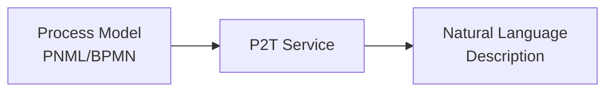
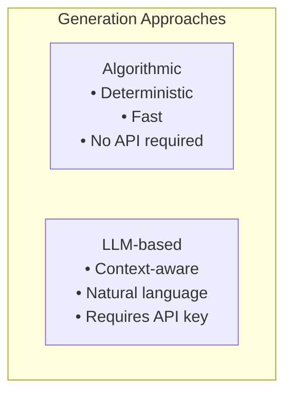

# Feature Overview

Complete overview of P2T service capabilities.

## Core Features

### 1. Process Model to Text Conversion

The primary function of P2T: converting process models into natural language descriptions.



### 2. Multiple Generation Approaches



### 3. Multi-Provider LLM Support

| Provider | Description | Requires API Key |
|----------|-------------|------------------|
| OpenAI | GPT-4, GPT-3.5, etc. | Yes |
| Google Gemini | Gemini Pro, etc. | Yes |
| LM Studio | Local models | No |

### 4. RAG Enhancement

Retrieval Augmented Generation enriches LLM prompts with relevant domain knowledge.

## Feature Details

### Text Generation Modes

```mermaid
flowchart TB
    subgraph "Generation Modes"
        direction TB
        
        subgraph "Mode 1: Algorithmic"
            A1[Parse Model] --> A2[Build RPST]
            A2 --> A3[Create Sentence Plan]
            A3 --> A4[Generate Text]
        end
        
        subgraph "Mode 2: LLM"
            B1[Parse Model] --> B2[Transform to BPMN]
            B2 --> B3[Build Prompt]
            B3 --> B4[Query LLM]
            B4 --> B5[Return Response]
        end
        
        subgraph "Mode 3: LLM + RAG"
            C1[Parse Model] --> C2[Transform to BPMN]
            C2 --> C3[Query RAG]
            C3 --> C4[Enrich Prompt]
            C4 --> C5[Query LLM]
            C5 --> C6[Return Response]
        end
    end
```



### Input Format Support

| Format | Extension | Description |
|--------|-----------|-------------|
| PNML | `.pnml` | Petri Net Markup Language |
| BPMN | `.bpmn` | Business Process Model and Notation |

Both formats are automatically detected and processed appropriately.

### Output Characteristics

#### Algorithmic Output

- Structured sentences following a template
- Consistent formatting
- Process flow clearly described
- Gateway logic explained

Example:
> The process begins with activity "Receive Order". Then, activity "Check Stock" is executed. If stock is available, the process continues with "Ship Order". Otherwise, "Backorder Item" is performed. The process ends.

#### LLM Output

- Natural, fluent language
- Context-aware descriptions
- More detailed explanations
- Customizable style (via prompt)

Example:
> This business process describes an order fulfillment workflow. When an order is received, the stock availability is first verified. If sufficient inventory exists, the order proceeds directly to shipping. However, if stock is insufficient, a backorder is created to fulfill the request once inventory is replenished.

## API Endpoints

### Generate Text (Algorithmic)

```http
POST /p2t/generateText
Content-Type: text/plain

<?xml version="1.0"?>
<pnml>...</pnml>
```

**Response:**
```
The process begins with...
```

### Generate Text (LLM)

```http
POST /p2t/generateTextLLM?apiKey={key}&provider={provider}&gptModel={model}&useRag={bool}
Content-Type: text/plain

<?xml version="1.0"?>
<pnml>...</pnml>
```

**Parameters:**
- `apiKey` - API key for the provider
- `provider` - `openai`, `gemini`, or `lmstudio`
- `gptModel` - Model name (e.g., `gpt-4`, `gemini-pro`)
- `useRag` - `true` to enable RAG enhancement

**Response:**
```
This business process describes...
```

### List Models

```http
GET /p2t/gptModels?apiKey={key}&provider={provider}
```

**Response:**
```json
["gpt-4", "gpt-4-turbo", "gpt-3.5-turbo"]
```

### RAG Search

```http
POST /p2t/rag/search
Content-Type: application/json

{
    "query": "order fulfillment process"
}
```

### RAG Health

```http
GET /p2t/rag/health
```

## Comparison Table

| Aspect | Algorithmic | LLM | LLM + RAG |
|--------|-------------|-----|-----------|
| Speed | Fast | Medium | Slower |
| Cost | Free | Per token | Per token |
| Internet | Not required | Required* | Required |
| Consistency | High | Variable | Variable |
| Naturalness | Template-based | High | High |
| Domain Knowledge | None | General | Enhanced |
| API Key | No | Yes* | Yes |

*LM Studio doesn't require internet or API keys but needs local setup.

## Use Case Recommendations

### Documentation Generation

**Recommended:** LLM-based generation
- Produces more readable documentation
- Can adapt tone and style

### Quick Overview

**Recommended:** Algorithmic generation
- Fast results
- No external dependencies

### Domain-Specific Processes

**Recommended:** LLM + RAG
- Incorporates domain terminology
- More accurate descriptions

### Offline/Secure Environments

**Recommended:** Algorithmic or LM Studio
- No data leaves the network
- No external API calls

## Limitations

### Algorithmic Generation

- Template-based output (less natural)
- Limited to predefined patterns
- No customization options

### LLM Generation

- Requires API access and keys
- Cost per request
- Potential latency
- Occasional hallucinations

### RAG Enhancement

- Requires RAG service running
- Quality depends on knowledge base
- Additional latency
