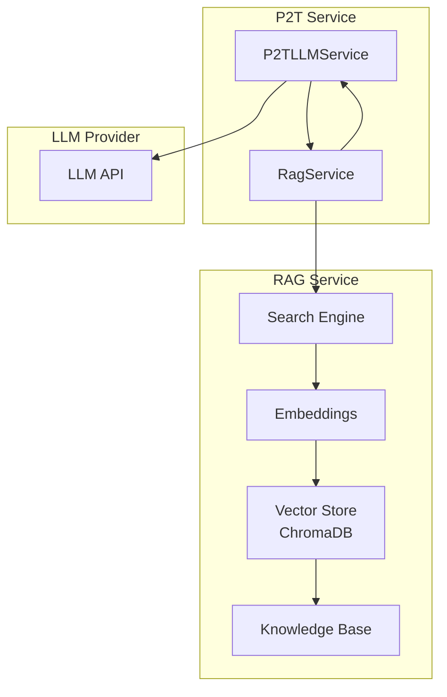
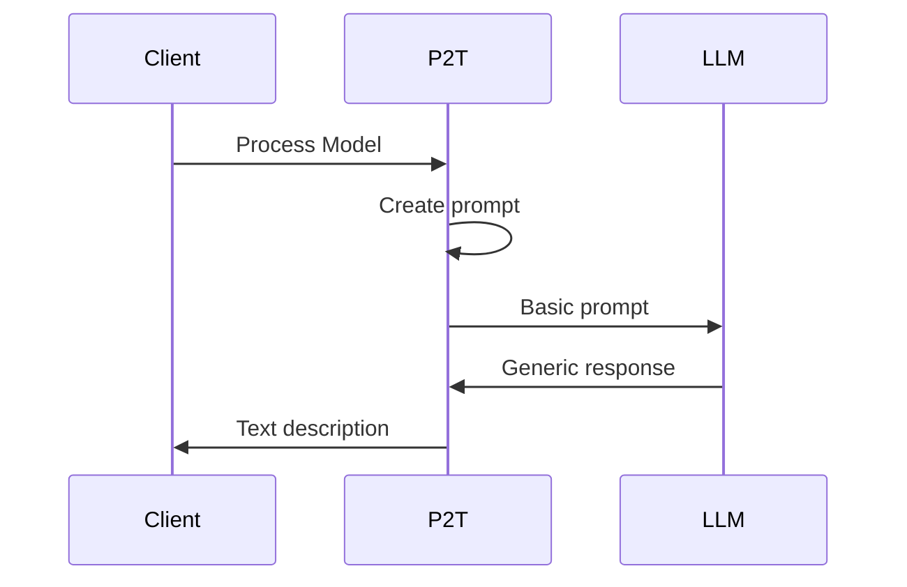
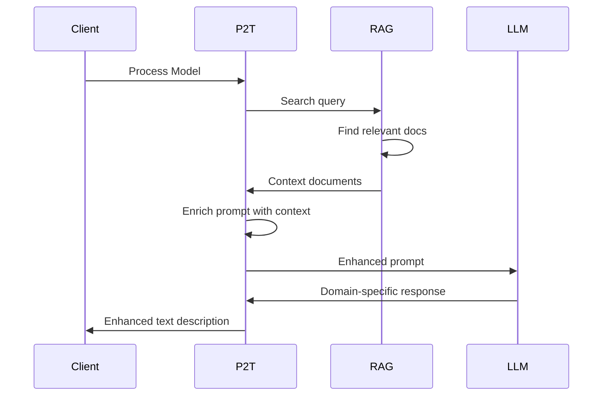
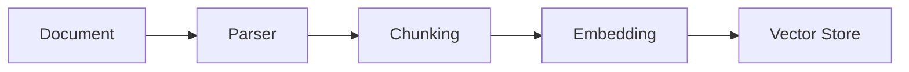
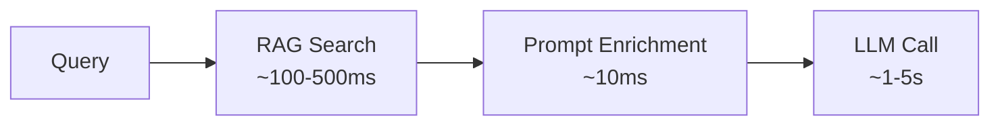
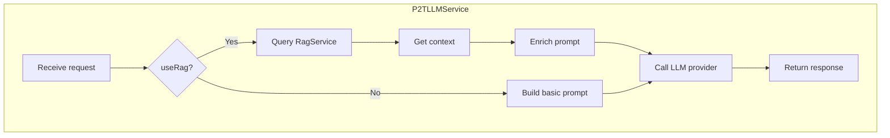

# RAG Integration

Retrieval Augmented Generation (RAG) for enhanced LLM-based text generation.

## Overview

RAG enhances LLM responses by providing relevant context from a knowledge base, resulting in more accurate and domain-specific process descriptions.



## How RAG Works

### Without RAG



### With RAG



## Benefits

| Aspect | Without RAG | With RAG |
|--------|-------------|----------|
| Domain terminology | Generic | Domain-specific |
| Accuracy | Good | Better |
| Context awareness | Limited | Enhanced |
| Consistency | Variable | More consistent |

## API Endpoints

### Generate Text with RAG

Enable RAG by setting `useRag=true`:

```bash
curl -X POST "http://localhost:8080/p2t/generateTextLLM?apiKey=...&provider=openai&gptModel=gpt-4&useRag=true" \
  -H "Content-Type: text/plain" \
  -d '<pnml>...</pnml>'
```

### RAG Search

Query the RAG knowledge base directly:

```bash
curl -X POST "http://localhost:8080/p2t/rag/search" \
  -H "Content-Type: application/json" \
  -d '{"query": "order fulfillment process"}'
```

**Response:**
```json
{
    "results": [
        {
            "content": "Order fulfillment involves receiving, processing, and delivering customer orders...",
            "score": 0.92,
            "metadata": {
                "source": "operations_manual.pdf",
                "page": 45
            }
        }
    ]
}
```

### RAG Health Check

```bash
curl http://localhost:8080/p2t/rag/health
```

**Response:**
```json
{
    "status": "healthy",
    "vectorStore": "connected",
    "documentsCount": 1523
}
```

## RAG Service Configuration

### Service URL

```bash
# Environment variable
export RAG_SERVICE_URL=http://rag-service:5000

# application.properties
rag.service.url=http://rag-service:5000
```

### Docker Compose

```yaml
services:
  p2t:
    environment:
      - RAG_SERVICE_URL=http://rag:5000
    depends_on:
      - rag
  
  rag:
    image: woped/rag:latest
    ports:
      - "5000:5000"
    volumes:
      - rag-data:/app/chroma_db
```

## Knowledge Base

### Supported Document Types

| Type | Extension | Description |
|------|-----------|-------------|
| PDF | `.pdf` | Document files |
| Text | `.txt` | Plain text |
| Markdown | `.md` | Markdown files |
| Word | `.docx` | Word documents |

### Adding Documents

Documents can be added to the RAG service's knowledge base:

```bash
curl -X POST http://rag-service:5000/upload \
  -F "file=@operations_manual.pdf"
```

### Document Processing



## Use Cases

### Domain-Specific Processes

**Scenario:** Healthcare process model

**Without RAG:**
> The process begins with patient registration. Then, the examination is performed...

**With RAG:**
> The clinical workflow initiates with patient intake and EHR registration. Subsequently, the attending physician conducts the initial assessment following HIPAA guidelines...

### Technical Processes

**Scenario:** Software deployment process

**Without RAG:**
> The deployment process starts with code changes. Then, testing is done...

**With RAG:**
> The CI/CD pipeline triggers upon merge to main branch. Automated unit and integration tests execute in the staging environment. Following successful QA validation, the blue-green deployment strategy promotes changes to production...

### Business Processes

**Scenario:** Purchase order workflow

**Without RAG:**
> The purchase begins with a request. Then, approval is obtained...

**With RAG:**
> The procurement process initiates when a requisitioner submits a purchase request in SAP. The request routes to the appropriate cost center manager based on delegation of authority limits. Requests exceeding $10,000 require VP-level approval...

## Best Practices

### When to Use RAG

| Use RAG | Don't Use RAG |
|---------|---------------|
| Domain-specific processes | Generic process descriptions |
| Complex business rules | Simple sequential processes |
| Compliance requirements | Quick overviews |
| Consistent terminology | Ad-hoc queries |

### Knowledge Base Quality

- **Keep documents updated** - Outdated info leads to incorrect descriptions
- **Use authoritative sources** - Internal documentation, standards, manuals
- **Organize by domain** - Group related documents
- **Remove duplicates** - Avoid conflicting information

### Performance Considerations



- RAG adds ~100-500ms latency
- Trade-off: Better quality vs. slightly slower
- Consider caching for repeated queries

## Error Handling

### Common Errors

| Error | Cause | Solution |
|-------|-------|----------|
| RAG unavailable | Service down | Check RAG service status |
| No results | Empty knowledge base | Add relevant documents |
| Timeout | Slow search | Increase timeout or optimize |
| Invalid query | Malformed request | Check request format |

### Fallback Behavior

When RAG is unavailable, P2T can:
1. Return error to client
2. Fall back to non-RAG generation
3. Return cached results (if available)

```java
try {
    context = ragService.search(query);
    prompt = enrichPrompt(basePrompt, context);
} catch (RagException e) {
    log.warn("RAG unavailable, using basic prompt", e);
    prompt = basePrompt; // Fallback
}
```

## Architecture Details

### RagService Class

The `RagService` class handles RAG interactions:

```java
@Service
public class RagService {
    
    public String searchAndEnrich(String query) {
        // Query RAG service
        // Return enriched context
    }
    
    public boolean isHealthy() {
        // Check RAG service health
    }
}
```

### Integration Flow



## Monitoring

### Metrics

| Metric | Description |
|--------|-------------|
| `rag.search.duration` | Search latency |
| `rag.search.results` | Number of results |
| `rag.search.errors` | Error count |
| `rag.health.status` | Service availability |

### Logging

```
INFO  RagService - Searching RAG with query: "order processing"
DEBUG RagService - Found 5 relevant documents
INFO  RagService - Enriched prompt with 3 context chunks
```

## Troubleshooting

### RAG Service Not Responding

```bash
# Check if RAG service is running
curl http://localhost:5000/health

# Check Docker logs
docker logs rag

# Verify network connectivity
docker exec p2t curl http://rag:5000/health
```

### Poor Search Results

1. **Check query quality** - Use descriptive queries
2. **Verify knowledge base** - Ensure relevant documents exist
3. **Adjust search parameters** - Modify similarity thresholds
4. **Review embeddings** - Ensure compatible embedding model

### High Latency

1. **Optimize vector store** - Index maintenance
2. **Reduce document size** - Smaller chunks
3. **Scale RAG service** - More resources
4. **Enable caching** - Cache frequent queries
