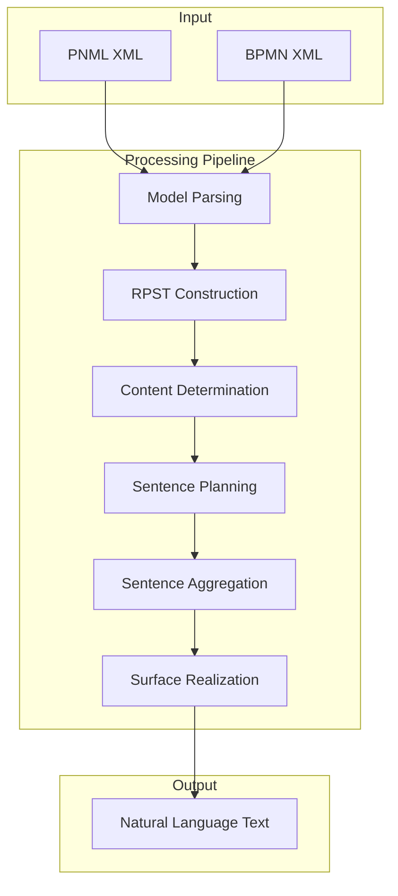
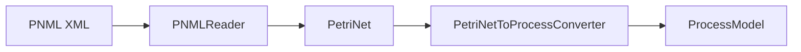
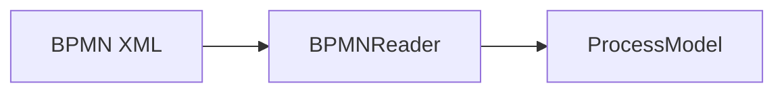
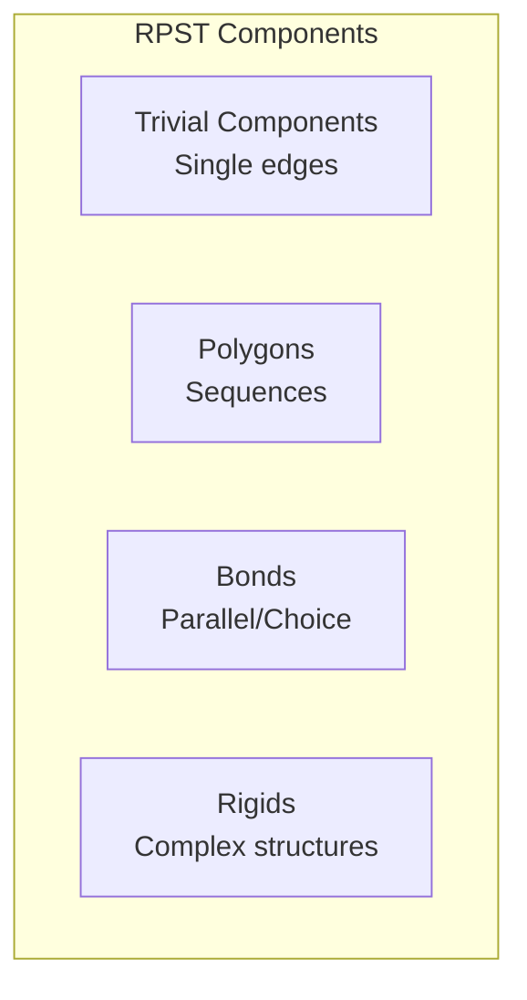
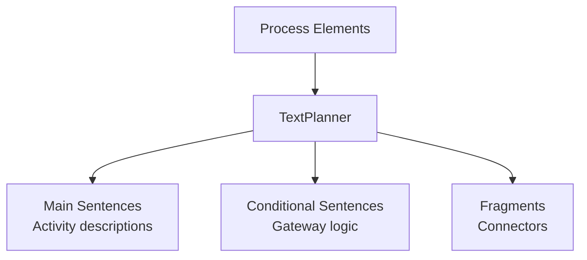

# Algorithmic Text Generation

Detailed documentation of the algorithmic (NLP-based) text generation feature.

## Overview

The algorithmic text generation approach uses Natural Language Processing (NLP) techniques to convert process models into natural language descriptions without requiring external AI services.



## Processing Pipeline

### Stage 1: Model Parsing

The input XML is parsed into an internal process model representation.

**PNML Parsing:**


**BPMN Parsing:**


### Stage 2: RPST Construction

The Refined Process Structure Tree (RPST) is built to analyze the process structure.



### Stage 3: Content Determination

Determines what content to include in the text based on process elements.

| Element | Content Type |
|---------|--------------|
| Activity | Action description |
| Gateway (XOR) | Decision point |
| Gateway (AND) | Parallel execution |
| Event (Start) | Process beginning |
| Event (End) | Process completion |

### Stage 4: Sentence Planning

Creates a sentence plan with DSynT (Deep Syntactic Tree) structures.



### Stage 5: Sentence Aggregation

Combines related sentences and adds discourse markers.

**Discourse Markers:**
- Sequence: "Then", "Next", "Subsequently"
- Parallel: "In parallel", "At the same time"
- Choice: "If... then", "Otherwise", "In case"
- End: "Finally", "The process ends"

### Stage 6: Surface Realization

Converts the sentence plan into final natural language text.

**SimpleNLG** is used for:
- Verb conjugation
- Noun phrase generation
- Sentence construction

## API Usage

### Endpoint

```http
POST /p2t/generateText
Content-Type: text/plain
```

### Request

Send the process model XML directly in the request body:

```xml
<?xml version="1.0" encoding="UTF-8"?>
<pnml>
  <net id="order-process" type="http://www.pnml.org/version-2009/grammar/pnmlcoremodel">
    <place id="p1">
      <name><text>Start</text></name>
    </place>
    <transition id="t1">
      <name><text>Receive Order</text></name>
    </transition>
    <transition id="t2">
      <name><text>Process Payment</text></name>
    </transition>
    <transition id="t3">
      <name><text>Ship Order</text></name>
    </transition>
    <place id="p2">
      <name><text>End</text></name>
    </place>
    <arc id="a1" source="p1" target="t1"/>
    <arc id="a2" source="t1" target="t2"/>
    <arc id="a3" source="t2" target="t3"/>
    <arc id="a4" source="t3" target="p2"/>
  </net>
</pnml>
```

### Response

```
The process begins when the order is received. Then, the payment is processed. 
Finally, the order is shipped and the process completes.
```

## Output Patterns

### Sequential Flow

**Input Pattern:**
```
Start → Activity A → Activity B → Activity C → End
```

**Output:**
> The process begins with Activity A. Then, Activity B is performed. Finally, Activity C is executed and the process completes.

### XOR Gateway (Decision)

**Input Pattern:**
```
Start → Gateway → [Condition A] → Activity A → Join
              → [Condition B] → Activity B → Join → End
```

**Output:**
> The process begins. If Condition A holds, Activity A is performed. Otherwise, Activity B is executed. The process then completes.

### AND Gateway (Parallel)

**Input Pattern:**
```
Start → Gateway → Activity A → Join → End
              → Activity B → Join
```

**Output:**
> The process begins. In parallel, Activity A and Activity B are executed. Once both are completed, the process ends.

### Loop

**Input Pattern:**
```
Start → Activity A → Gateway → [Continue] → Activity A (loop back)
                           → [Exit] → End
```

**Output:**
> The process begins with Activity A. The activity may be repeated. Once the condition is met, the process completes.

## Configuration

### Language Settings

Currently, only English is fully supported for text generation.

```java
// In TextGenerator configuration
Locale.setDefault(Locale.ENGLISH);
```

### Sentence Style

The generated text follows these conventions:
- Active voice preferred
- Present tense for actions
- Proper sentence structure
- Discourse markers for flow

## Limitations

### Process Complexity

- Very complex models may produce verbose output
- Deeply nested structures can be hard to describe
- Some patterns may not be fully supported

### Language Support

- Primary support for English
- Label text is used directly from the model
- Special characters may need handling

### Model Requirements

- Activities should have meaningful labels
- Gateways benefit from condition labels
- Start and end events should be properly marked

## Examples

### Simple Order Process

**Input:** Order process with receive, validate, and ship

**Output:**
> The process begins when the order is received. First, the order is validated. If the order is valid, it is shipped to the customer. Otherwise, the order is rejected. The process then completes.

### Approval Workflow

**Input:** Document approval with review and decision

**Output:**
> The process starts with the submission of a document. The document is then reviewed by the manager. If approved, the document is published. If rejected, it is returned to the author for revision. The process may iterate until approval is granted or the submission is withdrawn.

## Best Practices

### For Best Results

1. **Use clear activity labels**
   - "Process Order" instead of "t1"
   - Verb + Object format works best

2. **Label gateway conditions**
   - "Stock available" instead of just "yes"
   - Makes output more meaningful

3. **Structure process clearly**
   - Avoid unnecessary complexity
   - Use proper start and end events

4. **Validate input XML**
   - Ensure well-formed XML
   - Follow PNML/BPMN standards

### Common Issues

| Issue | Solution |
|-------|----------|
| Generic output | Improve activity labels |
| Missing conditions | Add gateway condition labels |
| Unclear flow | Simplify process structure |
| Parsing errors | Validate XML format |
