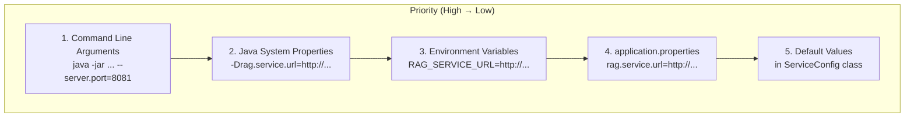

# Configuration Guide

Complete configuration reference for the P2T service.

## Configuration Sources

P2T uses Spring Boot's configuration mechanism with the following priority (highest to lowest):



## External Service URLs

### ServiceConfig Properties

| Property | Environment Variable | Default | Description |
|----------|---------------------|---------|-------------|
| `rag.service.url` | `RAG_SERVICE_URL` | `http://localhost:5000` | RAG service endpoint |
| `transformer.service.url` | `TRANSFORMER_SERVICE_URL` | `http://localhost:5001` | model-transformer endpoint |
| `openai.api.url` | `OPENAI_API_URL` | `https://api.openai.com/v1` | OpenAI API base URL |
| `gemini.api.url` | `GEMINI_API_URL` | `https://generativelanguage.googleapis.com` | Gemini API URL |
| `lmstudio.api.url` | `LMSTUDIO_API_URL` | `http://localhost:1234` | LM Studio API URL |

### Examples

**application.properties:**
```properties
rag.service.url=http://rag-service:5000
transformer.service.url=http://transformer:5001
openai.api.url=https://api.openai.com/v1
gemini.api.url=https://generativelanguage.googleapis.com
lmstudio.api.url=http://lmstudio:1234
```

**Environment Variables:**
```bash
export RAG_SERVICE_URL=http://rag-service:5000
export TRANSFORMER_SERVICE_URL=http://transformer:5001
```

**Java System Properties:**
```bash
java -jar p2t.jar \
  -Drag.service.url=http://rag-service:5000 \
  -Dtransformer.service.url=http://transformer:5001
```

## Spring Boot Configuration

### Server Settings

```properties
# Server port
server.port=8080

# Context path
server.servlet.context-path=/p2t

# Request body size limit
server.tomcat.max-http-form-post-size=10MB
spring.servlet.multipart.max-file-size=10MB
spring.servlet.multipart.max-request-size=10MB
```

### Logging

```properties
# Log level
logging.level.root=INFO
logging.level.de.dhbw.woped=DEBUG

# Log format
logging.pattern.console=%d{yyyy-MM-dd HH:mm:ss} - %msg%n

# File logging
logging.file.name=p2t.log
logging.file.path=/var/log/p2t
```

### Actuator (Health & Metrics)

```properties
# Expose all actuator endpoints
management.endpoints.web.exposure.include=health,info,metrics,prometheus

# Health endpoint details
management.endpoint.health.show-details=always

# Custom health indicators
management.health.defaults.enabled=true
```

## Docker Configuration

### Environment File (p2t.env)

```bash
# External Services
RAG_SERVICE_URL=http://rag:5000
TRANSFORMER_SERVICE_URL=http://model-transformer:5001

# LLM APIs
OPENAI_API_URL=https://api.openai.com/v1
GEMINI_API_URL=https://generativelanguage.googleapis.com
LMSTUDIO_API_URL=http://lmstudio:1234

# Java Options
JAVA_OPTS=-Xmx512m -Xms256m
```

### Docker Compose

```yaml
services:
  p2t:
    image: woped/process2text:latest
    ports:
      - "8080:8080"
    env_file:
      - p2t.env
    environment:
      # Override individual values
      - JAVA_OPTS=-Xmx1g
    depends_on:
      - rag
      - model-transformer
    healthcheck:
      test: ["CMD", "curl", "-f", "http://localhost:8080/actuator/health"]
      interval: 30s
      timeout: 10s
      retries: 3
```

## Production Configuration

### Recommended Settings

```properties
# Production profile
spring.profiles.active=prod

# Connection pool
spring.datasource.hikari.maximum-pool-size=10

# Server settings
server.tomcat.threads.max=200
server.tomcat.accept-count=100

# Timeouts
server.tomcat.connection-timeout=20000

# Compression
server.compression.enabled=true
server.compression.mime-types=application/json,text/plain,text/xml
```

### JVM Settings

```bash
# Production JVM options
JAVA_OPTS="-Xms512m -Xmx2g \
  -XX:+UseG1GC \
  -XX:MaxGCPauseMillis=200 \
  -XX:+HeapDumpOnOutOfMemoryError \
  -XX:HeapDumpPath=/var/log/p2t/heapdump.hprof"
```

## CORS Configuration

The `WebConfig` class configures CORS. Default settings:

```java
// Allowed origins
"http://localhost:4200"  // Angular dev
"http://localhost:8080"  // Local server
"https://woped.dhbw-karlsruhe.de"  // Production

// Allowed methods
GET, POST, PUT, DELETE, OPTIONS

// Allowed headers
*

// Credentials
true
```

To customize, modify `WebConfig.java` or use properties:

```properties
# Custom CORS origins (comma-separated)
cors.allowed-origins=http://localhost:4200,https://myapp.example.com
```

## LLM Provider Configuration

### OpenAI

No service-level configuration needed. API key provided per-request.

### Gemini

No service-level configuration needed. API key provided per-request.

### LM Studio

Requires running LM Studio server:

```bash
# Default port
LMSTUDIO_API_URL=http://localhost:1234

# Custom port
LMSTUDIO_API_URL=http://localhost:5678
```

## Configuration Best Practices

### Environment-Specific Files

```
src/main/resources/
├── application.properties          # Base configuration
├── application-dev.properties      # Development overrides
├── application-prod.properties     # Production overrides
└── application-test.properties     # Test overrides
```

### Sensitive Data

Never commit sensitive data to version control:

```bash
# .gitignore
*.env
application-local.properties
```

Use environment variables for secrets:

```bash
# API keys should NEVER be in config files
# They're provided per-request by users
```

### Validation

Validate configuration on startup:

```java
@PostConstruct
public void validateConfig() {
    log.info("RAG Service URL: {}", ragServiceUrl);
    log.info("Transformer URL: {}", transformerServiceUrl);
    // Add validation logic
}
```

## Troubleshooting Configuration

### Check Active Configuration

```bash
# View all properties
curl http://localhost:8080/actuator/env

# View specific property
curl http://localhost:8080/actuator/env/rag.service.url
```

### Override Issues

If values aren't being picked up:

1. Check property name case sensitivity
2. Check environment variable naming (use underscores, uppercase)
3. Check profile activation
4. Check for typos

### Docker Configuration Issues

```bash
# Inspect container environment
docker exec p2t env

# Check logs for config loading
docker logs p2t | grep -i "config\|url"
```
