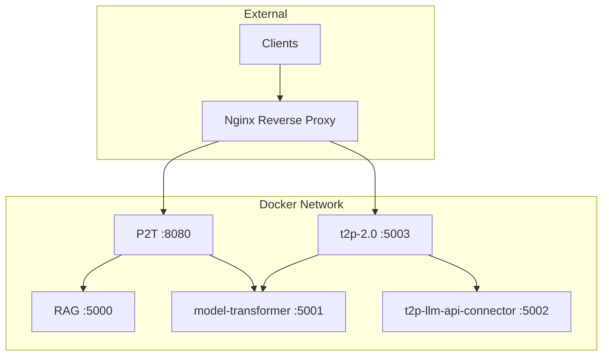

# Docker Deployment

Guide for deploying P2T using Docker and Docker Compose.

## Docker Image

### Pull from Docker Hub

```bash
docker pull woped/process2text:latest
```

### Build Locally

```bash
cd P2T
docker build -t woped/process2text:local .
```

## Standalone Deployment

### Basic Run

```bash
docker run -p 8080:8080 woped/process2text
```

### With Environment Variables

```bash
docker run -p 8080:8080 \
  -e RAG_SERVICE_URL=http://host.docker.internal:5000 \
  -e TRANSFORMER_SERVICE_URL=http://host.docker.internal:5001 \
  woped/process2text
```

### With Environment File

```bash
# Create p2t.env
cat > p2t.env << EOF
RAG_SERVICE_URL=http://rag:5000
TRANSFORMER_SERVICE_URL=http://transformer:5001
JAVA_OPTS=-Xmx1g
EOF

# Run with env file
docker run -p 8080:8080 --env-file p2t.env woped/process2text
```

## Docker Compose Deployment

### Full Stack Architecture



### docker-compose.yml

```yaml
version: '3.8'

services:
  p2t:
    image: woped/process2text:latest
    container_name: p2t
    ports:
      - "8080:8080"
    env_file:
      - p2t.env
    depends_on:
      rag:
        condition: service_healthy
      model-transformer:
        condition: service_healthy
    healthcheck:
      test: ["CMD", "curl", "-f", "http://localhost:8080/actuator/health"]
      interval: 30s
      timeout: 10s
      retries: 3
      start_period: 60s
    networks:
      - woped-network
    restart: unless-stopped

  rag:
    image: woped/rag:latest
    container_name: rag
    ports:
      - "5000:5000"
    volumes:
      - rag-data:/app/chroma_db
    healthcheck:
      test: ["CMD", "curl", "-f", "http://localhost:5000/health"]
      interval: 30s
      timeout: 10s
      retries: 3
    networks:
      - woped-network
    restart: unless-stopped

  model-transformer:
    image: woped/model-transformer:latest
    container_name: model-transformer
    ports:
      - "5001:5001"
    healthcheck:
      test: ["CMD", "curl", "-f", "http://localhost:5001/health"]
      interval: 30s
      timeout: 10s
      retries: 3
    networks:
      - woped-network
    restart: unless-stopped

networks:
  woped-network:
    driver: bridge

volumes:
  rag-data:
```

### Environment File (p2t.env)

```bash
# Service URLs (using Docker service names)
RAG_SERVICE_URL=http://rag:5000
TRANSFORMER_SERVICE_URL=http://model-transformer:5001

# LLM APIs
OPENAI_API_URL=https://api.openai.com/v1
GEMINI_API_URL=https://generativelanguage.googleapis.com
LMSTUDIO_API_URL=http://host.docker.internal:1234

# JVM Settings
JAVA_OPTS=-Xms256m -Xmx1g -XX:+UseG1GC
```

### Start Services

```bash
# Start all services
docker-compose up -d

# Start specific service
docker-compose up -d p2t

# View logs
docker-compose logs -f p2t

# Check status
docker-compose ps
```

## Production Deployment

### With Nginx Reverse Proxy

```yaml
services:
  nginx:
    image: nginx:alpine
    ports:
      - "80:80"
      - "443:443"
    volumes:
      - ./nginx.conf:/etc/nginx/nginx.conf:ro
      - ./certs:/etc/nginx/certs:ro
    depends_on:
      - p2t
    networks:
      - woped-network

  p2t:
    # ... same as above, but without exposed ports
    expose:
      - "8080"
```

### nginx.conf Example

```nginx
upstream p2t {
    server p2t:8080;
}

server {
    listen 80;
    server_name woped.example.com;
    return 301 https://$server_name$request_uri;
}

server {
    listen 443 ssl;
    server_name woped.example.com;

    ssl_certificate /etc/nginx/certs/cert.pem;
    ssl_certificate_key /etc/nginx/certs/key.pem;

    location /p2t/ {
        proxy_pass http://p2t/;
        proxy_set_header Host $host;
        proxy_set_header X-Real-IP $remote_addr;
        proxy_set_header X-Forwarded-For $proxy_add_x_forwarded_for;
        proxy_set_header X-Forwarded-Proto $scheme;
    }
}
```

## Resource Management

### Memory Limits

```yaml
services:
  p2t:
    deploy:
      resources:
        limits:
          memory: 2G
        reservations:
          memory: 512M
    environment:
      - JAVA_OPTS=-Xms512m -Xmx1536m
```

### CPU Limits

```yaml
services:
  p2t:
    deploy:
      resources:
        limits:
          cpus: '2'
        reservations:
          cpus: '0.5'
```

## Health Checks

### Custom Health Check Script

```bash
#!/bin/bash
# healthcheck.sh

response=$(curl -s -o /dev/null -w "%{http_code}" http://localhost:8080/actuator/health)

if [ "$response" = "200" ]; then
    exit 0
else
    exit 1
fi
```

### Using in Docker Compose

```yaml
healthcheck:
  test: ["CMD", "/app/healthcheck.sh"]
  interval: 30s
  timeout: 10s
  retries: 3
  start_period: 60s
```

## Logging

### View Logs

```bash
# Follow logs
docker-compose logs -f p2t

# Last 100 lines
docker-compose logs --tail 100 p2t

# Since timestamp
docker-compose logs --since "2024-01-01" p2t
```

### Log Aggregation with Promtail

```yaml
services:
  promtail:
    image: grafana/promtail:latest
    volumes:
      - /var/lib/docker/containers:/var/lib/docker/containers:ro
      - ./promtail-config.yml:/etc/promtail/config.yml:ro
    command: -config.file=/etc/promtail/config.yml
```

## Updating Services

### Rolling Update

```bash
# Pull new images
docker-compose pull

# Recreate containers
docker-compose up -d --force-recreate

# Or for specific service
docker-compose up -d --force-recreate p2t
```

### Zero-Downtime Update

```bash
# Scale up
docker-compose up -d --scale p2t=2

# Wait for new instance to be healthy
sleep 30

# Scale down old instance
docker-compose up -d --scale p2t=1
```

## Troubleshooting

### Container Won't Start

```bash
# Check logs
docker-compose logs p2t

# Check container status
docker-compose ps

# Inspect container
docker inspect p2t
```

### Connection Issues

```bash
# Check network
docker network inspect woped-network

# Test connectivity between containers
docker exec p2t curl http://rag:5000/health
```

### Memory Issues

```bash
# Check memory usage
docker stats p2t

# Increase memory limit
docker-compose up -d --memory 2g p2t
```
