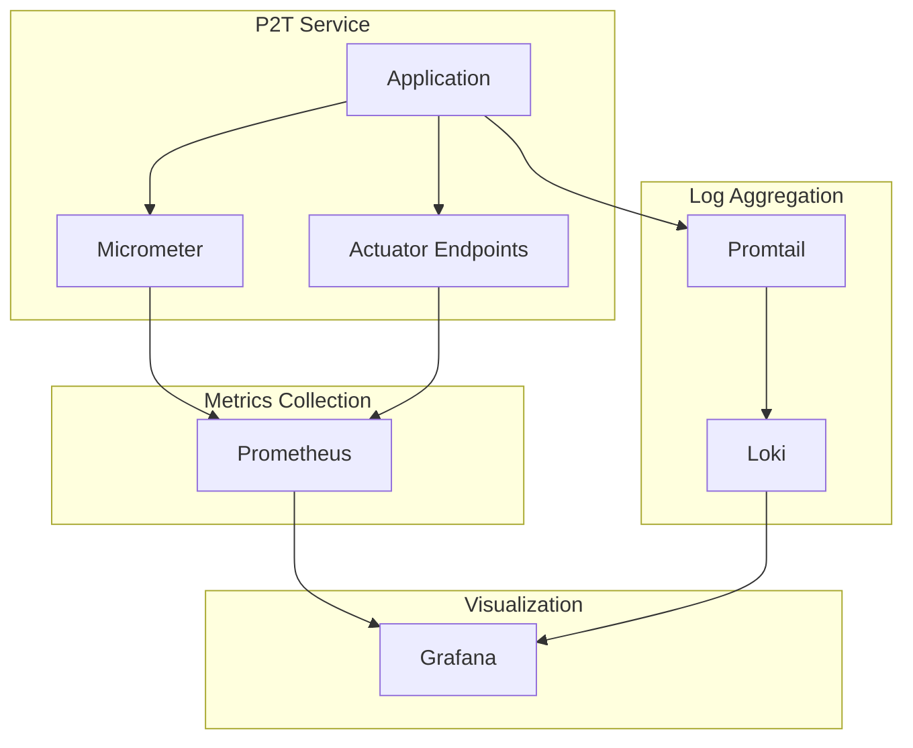
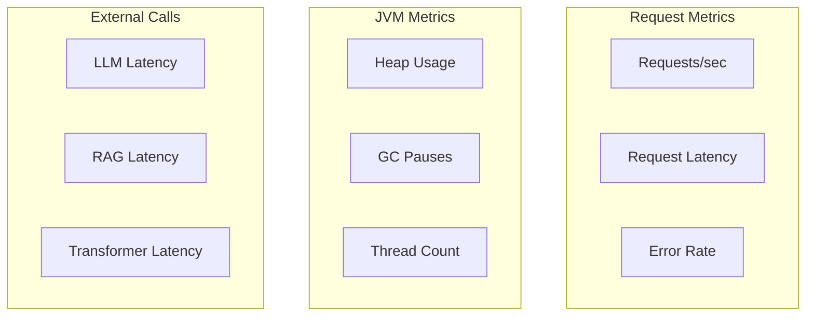
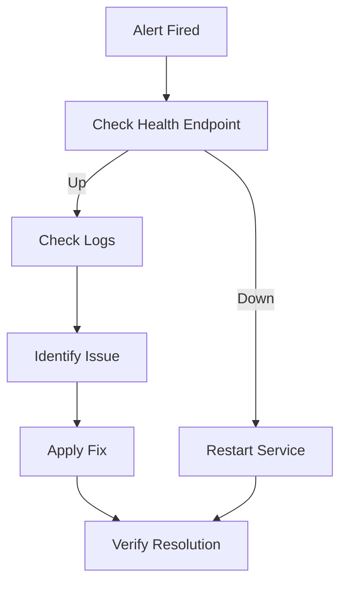

# Monitoring Guide

Monitoring, metrics, and observability for the P2T service.

## Overview



## Health Checks

### Actuator Health Endpoint

```bash
curl http://localhost:8080/actuator/health
```

Response:
```json
{
    "status": "UP",
    "components": {
        "diskSpace": {
            "status": "UP",
            "details": {
                "total": 499963174912,
                "free": 234567890123,
                "threshold": 10485760
            }
        },
        "ping": {
            "status": "UP"
        }
    }
}
```

### Custom Health Indicators

P2T can include custom health checks for dependencies:

```java
@Component
public class RagHealthIndicator implements HealthIndicator {
    
    @Override
    public Health health() {
        // Check RAG service availability
        if (ragService.isAvailable()) {
            return Health.up().build();
        }
        return Health.down()
            .withDetail("error", "RAG service unavailable")
            .build();
    }
}
```

### Docker Health Check

```yaml
healthcheck:
  test: ["CMD", "curl", "-f", "http://localhost:8080/actuator/health"]
  interval: 30s
  timeout: 10s
  retries: 3
  start_period: 60s
```

## Metrics

### Built-in Metrics

P2T exposes the following custom metrics:

| Metric | Type | Description |
|--------|------|-------------|
| `http.requests.total` | Counter | Total HTTP requests |
| `http.request.duration` | Timer | Request duration |
| `api.call.duration` | Timer | External API call duration |

### Prometheus Endpoint

```bash
curl http://localhost:8080/actuator/prometheus
```

Example output:
```
# HELP http_requests_total Total number of HTTP requests
# TYPE http_requests_total counter
http_requests_total 42

# HELP http_request_duration_seconds Request duration
# TYPE http_request_duration_seconds histogram
http_request_duration_seconds_bucket{le="0.1"} 35
http_request_duration_seconds_bucket{le="0.5"} 40
http_request_duration_seconds_bucket{le="1.0"} 42
http_request_duration_seconds_sum 15.234
http_request_duration_seconds_count 42
```

### JVM Metrics

Automatically exposed:
- `jvm.memory.used`
- `jvm.memory.max`
- `jvm.gc.pause`
- `jvm.threads.live`
- `process.cpu.usage`

### Prometheus Configuration

```yaml
# prometheus.yml
scrape_configs:
  - job_name: 'p2t'
    metrics_path: '/actuator/prometheus'
    static_configs:
      - targets: ['p2t:8080']
    scrape_interval: 15s
```

## Logging

### Log Configuration

```properties
# application.properties
logging.level.root=INFO
logging.level.de.dhbw.woped=DEBUG

# JSON format for log aggregation
logging.pattern.console={"timestamp":"%d","level":"%p","logger":"%c","message":"%m"}%n
```

### Logstash Format

Using `logstash-logback-encoder`:

```xml
<!-- logback-spring.xml -->
<configuration>
    <appender name="STDOUT" class="ch.qos.logback.core.ConsoleAppender">
        <encoder class="net.logstash.logback.encoder.LogstashEncoder">
            <includeMdcKeyName>requestId</includeMdcKeyName>
        </encoder>
    </appender>
    
    <root level="INFO">
        <appender-ref ref="STDOUT"/>
    </root>
</configuration>
```

### Log Levels

| Logger | Level | Purpose |
|--------|-------|---------|
| `root` | INFO | Default level |
| `de.dhbw.woped` | DEBUG | Application code |
| `org.springframework.web` | WARN | Spring Web |
| `org.apache.http` | WARN | HTTP client |

### Structured Logging

```java
log.info("Processing request",
    kv("provider", provider),
    kv("model", model),
    kv("useRag", useRag));
```

Output:
```json
{
    "timestamp": "2024-01-15T10:30:00.000Z",
    "level": "INFO",
    "logger": "de.dhbw.woped.process2text.controller.P2TController",
    "message": "Processing request",
    "provider": "openai",
    "model": "gpt-4",
    "useRag": false
}
```

## Grafana Dashboards

### P2T Overview Dashboard



### Key Panels

**Request Rate:**
```promql
rate(http_requests_total{job="p2t"}[5m])
```

**Request Latency (p95):**
```promql
histogram_quantile(0.95, rate(http_request_duration_seconds_bucket{job="p2t"}[5m]))
```

**Error Rate:**
```promql
rate(http_requests_total{job="p2t",status=~"5.."}[5m]) / rate(http_requests_total{job="p2t"}[5m])
```

**JVM Heap Usage:**
```promql
jvm_memory_used_bytes{job="p2t",area="heap"} / jvm_memory_max_bytes{job="p2t",area="heap"}
```

### Dashboard JSON

```json
{
    "title": "P2T Service",
    "panels": [
        {
            "title": "Request Rate",
            "type": "graph",
            "targets": [{
                "expr": "rate(http_requests_total{job=\"p2t\"}[5m])"
            }]
        }
    ]
}
```

## Alerting

### Alert Rules

```yaml
# alerting_rules.yml
groups:
  - name: p2t
    rules:
      - alert: P2THighErrorRate
        expr: rate(http_requests_total{job="p2t",status=~"5.."}[5m]) > 0.1
        for: 5m
        labels:
          severity: critical
        annotations:
          summary: "High error rate on P2T service"
          description: "Error rate is {{ $value | humanizePercentage }}"
      
      - alert: P2THighLatency
        expr: histogram_quantile(0.95, rate(http_request_duration_seconds_bucket{job="p2t"}[5m])) > 5
        for: 5m
        labels:
          severity: warning
        annotations:
          summary: "High latency on P2T service"
          description: "95th percentile latency is {{ $value }}s"
      
      - alert: P2TDown
        expr: up{job="p2t"} == 0
        for: 1m
        labels:
          severity: critical
        annotations:
          summary: "P2T service is down"
```

### Alertmanager Configuration

```yaml
# alertmanager.yml
route:
  receiver: 'email-notifications'
  group_by: ['alertname']
  group_wait: 30s
  group_interval: 5m
  repeat_interval: 4h

receivers:
  - name: 'email-notifications'
    email_configs:
      - to: 'team@example.com'
        send_resolved: true
```

## Tracing (Optional)

### OpenTelemetry Integration

```xml
<!-- pom.xml -->
<dependency>
    <groupId>io.opentelemetry.instrumentation</groupId>
    <artifactId>opentelemetry-spring-boot-starter</artifactId>
</dependency>
```

```properties
# application.properties
otel.exporter.otlp.endpoint=http://jaeger:4317
otel.service.name=p2t
otel.traces.sampler=parentbased_traceidratio
otel.traces.sampler.arg=0.1
```

## Best Practices

### Monitoring Checklist

- [ ] Health check endpoint accessible
- [ ] Prometheus scraping configured
- [ ] Grafana dashboards deployed
- [ ] Alert rules configured
- [ ] Log aggregation working
- [ ] Runbooks documented

### Key Metrics to Monitor

1. **Availability**: Service health check
2. **Latency**: Request duration (p50, p95, p99)
3. **Throughput**: Requests per second
4. **Errors**: Error rate, error types
5. **Resources**: CPU, memory, threads

### Incident Response


